# TVTI Portal - Enhanced Entity-Relationship (EER) Specification

This document provides the formal Enhanced Entity-Relationship (EER) model for the **Twintec Vocational Training Institute (TVTI) Portal**.

---

## 1. High-Level Domain Architecture & Specialization

The TVTI Portal features a **Total, Disjoint Specialization Hierarchy** for the central entity **USER**:

$$\text{USER} = \text{STUDENT} \cup \text{INSTRUCTOR} \cup \text{ADMIN}$$
$$\text{STUDENT} \cap \text{INSTRUCTOR} = \emptyset, \quad \text{STUDENT} \cap \text{ADMIN} = \emptyset, \quad \text{INSTRUCTOR} \cap \text{ADMIN} = \emptyset$$

- **General Superclass**: `USER` (Contains global auth credentials, phone, NIC, profile photo, and security password reset hashes).
- **Subclass STUDENT**: Specializes with `index_number`, `registration_number`, `desired_course`, `is_graduated`, educational details, and guardian details.
- **Subclass INSTRUCTOR**: Specializes with assigned teaching batches and practical laboratory supervision quotas.
- **Subclass ADMIN**: Specializes with master batch scheduling, application verification, and user credential management.

---

## 2. Formal EER Diagram (Crows-Foot Notation)

```mermaid
erDiagram
    %% ==========================================
    %% USER & DISJOINT SPECIALIZATION
    %% ==========================================
    USER {
        ObjectId _id PK
        string name
        string email UK
        string password_hash
        string role "student | instructor | admin"
        string phone
        string nic
        string profile_photo
        boolean is_active
        boolean must_change_password
        date temp_password_expires_at
        date password_set_at
        string passwordResetOtpHash
        date passwordResetOtpExpiresAt
        date createdAt
        date updatedAt
    }

    STUDENT {
        ObjectId user_id FK, PK
        string index_number UK
        string registration_number
        string desired_course
        boolean is_graduated
        string highest_education
        string guardian_name
        string guardian_phone
    }

    INSTRUCTOR {
        ObjectId user_id FK, PK
        string phone
    }

    ADMIN {
        ObjectId user_id FK, PK
    }

    USER ||--o| STUDENT : "specializes_as (role='student')"
    USER ||--o| INSTRUCTOR : "specializes_as (role='instructor')"
    USER ||--o| ADMIN : "specializes_as (role='admin')"

    %% ==========================================
    %% ACADEMIC & BATCH STRUCTURE
    %% ==========================================
    COURSE {
        ObjectId _id PK
        string title
        string description
        number fee
        number duration_weeks
        boolean is_active
        string prerequisites
        date createdAt
    }

    BATCH {
        ObjectId _id PK
        string name
        ObjectId course_id FK
        date start_date
        date end_date
        number capacity
        string room
        string status "active | completed | cancelled"
        date createdAt
    }

    ENROLLMENT {
        ObjectId _id PK
        ObjectId student_id FK
        ObjectId batch_id FK
        date enrolled_date
        string status "active | completed | dropped"
        boolean batch_assignment_email_sent
    }

    COURSE ||--o{ BATCH : "offers"
    COURSE ||--o{ APPLICATION : "targeted_by"
    BATCH ||--o{ ENROLLMENT : "enrolled_in"
    STUDENT ||--o{ ENROLLMENT : "maintains"
    INSTRUCTOR }o--o{ BATCH : "instructs (instructor_ids)"

    %% ==========================================
    %% ADMISSION, ONBOARDING & PAYMENTS
    %% ==========================================
    APPLICATION {
        ObjectId _id PK
        string full_name
        string email
        string phone
        string nic_number
        ObjectId course_id FK
        string status "pending | contacted | paid | approved | rejected"
        string payment_method "bank_transfer | physical_pay"
        string payment_slip
        number total_course_fee
        number amount_paid
        string generated_index_number
        boolean terms_accepted
        date submitted_at
    }

    PAYMENT_SLIP {
        ObjectId _id PK
        ObjectId student_id FK
        ObjectId application_id FK
        number amount
        string payment_method "bank_transfer | online_transfer | physical_cash | other"
        string slip_url
        string status "pending | verified | rejected"
        ObjectId verified_by FK
        date verified_at
        date createdAt
    }

    OTP_VERIFICATION {
        ObjectId _id PK
        string email UK
        string otp_hash
        date expires_at
        number attempts
        boolean verified
        date verified_at
        date last_sent_at
    }

    STUDENT ||--o{ PAYMENT_SLIP : "submits"
    APPLICATION ||--o{ PAYMENT_SLIP : "attaches"
    ADMIN ||--o{ PAYMENT_SLIP : "verifies (verified_by)"

    %% ==========================================
    %% PRACTICAL SLOTS & RESERVATIONS
    %% ==========================================
    PRACTICE_SLOT {
        ObjectId _id PK
        ObjectId batch_id FK
        ObjectId instructor_id FK
        date week_start_date
        string day_of_week "Mon|Tue|Wed|Thu|Fri|Sat|Sun"
        string start_time
        string end_time
        number max_students
        string location
        string equipment_note
        boolean is_open
        date booking_deadline
        date createdAt
    }

    SLOT_BOOKING {
        ObjectId _id PK
        ObjectId slot_id FK
        ObjectId student_id FK
        string status "confirmed | cancellation_requested | cancelled"
        date booked_at
        string cancellation_reason
    }

    BATCH ||--o{ PRACTICE_SLOT : "allocates"
    INSTRUCTOR ||--o{ PRACTICE_SLOT : "supervises (MAX 1/day)"
    PRACTICE_SLOT ||--o{ SLOT_BOOKING : "has_reservations"
    STUDENT ||--o{ SLOT_BOOKING : "books (1 active/slot)"

    %% ==========================================
    %% CURRICULUM, EVALUATION & COMMUNICATIONS
    %% ==========================================
    VIDEO {
        ObjectId _id PK
        ObjectId batch_id FK
        ObjectId instructor_id FK
        string topic "Module Chapter"
        string title
        string cloudinary_url "Video / YouTube URL"
        string notes_url "PDF lecture notes"
        string content_type "video | material"
        number order_index
        date createdAt
    }

    ATTENDANCE {
        ObjectId _id PK
        ObjectId student_id FK
        ObjectId batch_id FK
        date session_date
        string status "present | absent | late | excused"
    }

    RESULT {
        ObjectId _id PK
        ObjectId student_id FK
        ObjectId batch_id FK
        string assessment_name
        number marks
        string grade
        date createdAt
    }

    ANNOUNCEMENT {
        ObjectId _id PK
        ObjectId batch_id FK "nullable (null=global broadcast)"
        ObjectId posted_by FK
        string title
        string message
        date createdAt
    }

    NOTIFICATION {
        ObjectId _id PK
        ObjectId user_id FK
        string title
        string message
        string type
        boolean is_read
        ObjectId related_id
        date createdAt
    }

    BATCH ||--o{ VIDEO : "contains"
    INSTRUCTOR ||--o{ VIDEO : "publishes"
    STUDENT ||--o{ ATTENDANCE : "logged_in"
    BATCH ||--o{ ATTENDANCE : "tracks"
    STUDENT ||--o{ RESULT : "earns"
    BATCH ||--o{ RESULT : "grades"
    USER ||--o{ ANNOUNCEMENT : "authors (posted_by)"
    BATCH ||--o{ ANNOUNCEMENT : "receives"
    USER ||--o{ NOTIFICATION : "receives_alert (user_id)"
```



---

## 3. Structural Constraints, Cardinalities & Business Rules

### A. Specialization Constraints
- **Disjoint & Total**: A `USER` must be either a `STUDENT`, `INSTRUCTOR`, or `ADMIN`. No user can be both.
- **Role Permissions**:
  - `STUDENT`: Restricted to batch curriculum (`Video`), personal attendance, slot booking, and viewing academic results.
  - `INSTRUCTOR`: Manages assigned batches, uploads course materials, supervises practical slots, grades results, and posts batch announcements.
  - `ADMIN`: Global privilege over users, batch assignments, applications, payment approvals, and master calendar scheduling.

### B. Practical Slot Scheduling Integrity Rules
1. **One Practical Slot Per Day Per Instructor**:
   - The backend validates that an `INSTRUCTOR` can supervise at most **one practical slot per calendar day** across all batches.
2. **One Active Booking Per Slot Per Student**:
   - Enforced by MongoDB partial unique compound index on `SlotBooking`:
     ```typescript
     { slot_id: 1, student_id: 1 }, { unique: true, partialFilterExpression: { status: { $in: ['confirmed', 'cancellation_requested'] } } }
     ```
3. **Capacity Constraints**:
   - Total confirmed reservations for a `PRACTICE_SLOT` cannot exceed `max_students`.

### C. Curriculum Organization (Unified Modular Coupling)
- `Video` entity acts as a polymorphic learning asset (`content_type: 'video' | 'material'`).
- Any video can optionally embed a `notes_url` (PDF notes) directly attached to the lecture.
- On the mobile and web clients, videos and PDF study materials are grouped and displayed inside the module accordion container (`moduleSectionBox`).

### D. Admissions & Payment Verification
- Prospective applicants submit an `APPLICATION` for a `COURSE`.
- When an application is approved by an `ADMIN`, a corresponding `USER` (role: `student`) is created, and an initial `ENROLLMENT` is linked to an active `BATCH`.
- `PAYMENT_SLIP` links to both `student_id` and `application_id`, verified by an `ADMIN` (`verified_by`).
